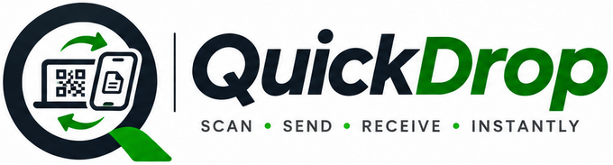

# QuickDrop

**A C Labs project for moving files between your phone and laptop.**

The preserved Android/Linux preview displays a QR on the laptop, scans it in the phone app, and automatically saves a file sent from the phone. It uses the local Wi-Fi network or phone hotspot without an account or a cloud upload in the native transfer flow.

## Download the preserved v0.5.2 preview

| Device | Download |
| --- | --- |
| Android 8+ | [QuickDrop_Offline_0.5.2.apk](offline/releases/v0.5.2/QuickDrop_Offline_0.5.2.apk) |
| Debian-compatible Linux / Chromebook with Linux enabled | [QuickDrop_Receiver_0.5.2_all.deb](offline/releases/v0.5.2/QuickDrop_Receiver_0.5.2_all.deb) |

[Install and pair](offline/docs/INSTALL.md) · [Architecture](offline/docs/ARCHITECTURE.md) · [Verification record](offline/docs/VERIFICATION.md) · [Demo guide](offline/docs/DEMO.md) · [SHA-256 checksums](offline/releases/v0.5.2/SHA256SUMS.txt)

## Two editions in this repository

| Edition | Source | Transfer model |
| --- | --- | --- |
| Android/Linux preview | [`offline/`](offline/) | Phone-hosted local HTTP streaming; laptop QR pairing, automatic saving and receipts |
| Browser application | Root Node.js app and [`public/`](public/) | Browser pairing, file/text sharing and temporary server storage |

See [browser app setup and deployment notes](docs/WEB_APP.md) for the existing web edition. The native Windows receiver is not packaged in this snapshot.

## Android/Linux features

- An on-device scanner that opens on a fresh launcher start, with a permanent Scan laptop QR action.
- QR ticket authentication, local discovery and remembered receiver access.
- One file per transfer with a 10,000,000,000-byte cap.
- Bounded streaming buffers, progress, pause/resume and duplicate filename protection.
- ETag and Range checks for resuming the same offer.
- Saved-file receipts after the receiver finishes writing.
- Parallel address checks with explicit connection stages and timeout messages.

The implementation combines Java/Android SDK 35 and ZXing with a Python/Tk receiver, python-zeroconf and python-qrcode. The [offline project README](offline/README.md) describes the source layout and design.

## Current status and limits

The v0.5.2 installers are preserved byte for byte with a release manifest and checksums. The verification record covers software authentication, streaming, resume, QR decoding and multicast fixtures. It distinguishes these checks from physical phone, Chromebook and network behavior; a full 10 GB native transfer is not independently verified.

**The native preview uses unencrypted HTTP.** QR proofs authenticate pairing but do not provide TLS or end-to-end encryption. Use a trusted password-protected private network and keep both apps open. Local discovery can be blocked by guest-network isolation or routing policies. The APK is debug-signed; signing keys and personal pairing state are excluded.

## Project context

QuickDrop is a personal C Labs portfolio project by Chaitanya Sai Medisetti, developed through an AI-assisted workflow, iterative product decisions and testing. The source, demo guide and verification notes make the work reviewable and support an accurate technical discussion.

The native project and test instructions are under `offline/`. Run its tests from that directory as described in [`offline/tests/README.txt`](offline/tests/README.txt).
