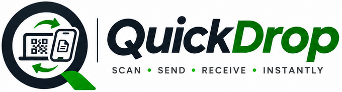

# QuickDrop

**A C Labs project — Android-to-laptop file sharing over a local network.**

Move a photo, video or document from an Android phone to a laptop without creating an account or uploading it to a cloud service. Show a QR on the laptop, scan it in the phone app, then choose a file and send it. The receiver saves it automatically.

This repository snapshot preserves **v0.5.2** of the Android app and Linux receiver, together with their source and software checks. It is a portfolio preview, with known networking and security limits described below.

## Try the preserved build

| Device | Preserved output |
| --- | --- |
| Android 8 or later | [QuickDrop_Offline_0.5.2.apk](releases/v0.5.2/QuickDrop_Offline_0.5.2.apk) |
| Debian-compatible Linux / Chromebook with Linux enabled | [QuickDrop_Receiver_0.5.2_all.deb](releases/v0.5.2/QuickDrop_Receiver_0.5.2_all.deb) |

[Installation and first transfer](docs/INSTALL.md) · [Architecture](docs/ARCHITECTURE.md) · [Verification](docs/VERIFICATION.md) · [Demo guide](docs/DEMO.md)

## Features

- A laptop QR and an on-device Android scanner for pairing.
- Remembered receiver access and automatic reconnection when the phone address stays unchanged.
- One file per transfer, capped at 10,000,000,000 bytes.
- Streamed transfers with progress, pause/resume and duplicate filename protection.
- File identity checks through HTTP ETag and range requests.
- A saved-file receipt sent after the receiver writes the file to disk.
- Parallel connection probes so a slow phone address does not hold up a reachable one.
- A manual connection fallback when the network blocks multicast discovery.

## Technology

| Component | Implementation |
| --- | --- |
| Android sender | Java, Android SDK 35, Camera API, ZXing 3.5.3, Android NSD |
| Desktop receiver | Python 3.9+, Tk, python-zeroconf, python-qrcode |
| Pairing | Optical ticket, DNS-SD/mDNS, HMAC-SHA256 challenge proofs |
| Transfer | Local HTTP streaming, cookies, ETag, Range, saved-file receipts |
| Distribution | Android APK and Debian package |

## Source layout

| Path | Contents |
| --- | --- |
| `QuickDropAndroid/` | Android app and phone HTTP server |
| `QuickDropLinux/` | Desktop UI, discovery and receiver |
| `tests/` | Java/Python protocol and QR checks |
| `releases/v0.5.2/` | Exact preserved outputs, checksums and release manifest |
| `docs/` | Setup, design, verification and demonstration notes |

## Current limits

Both devices need the same private Wi-Fi or phone hotspot. Internet is not part of the local pairing or file-transfer protocol; initial installation may download dependencies. Some networks block multicast or peer access. Keep the phone app open and the receiver running during transfers.

**File traffic uses unencrypted HTTP.** QR proofs authenticate the pairing ticket; they do not provide TLS or end-to-end encryption. Use a trusted password-protected network. The supplied APK is a debug-signed preview. Signing keys and personal pairing data are excluded from the source.

The Windows receiver is not included. A complete 10 GB Android-to-Chromebook transfer and compatibility across physical phones and networks have not been verified. See the [verification record](docs/VERIFICATION.md) for the exact scope.

## Portfolio context

QuickDrop is a personal C Labs project by Chaitanya Sai Medisetti, developed through an AI-assisted workflow, iterative product decisions and testing. This snapshot documents the implementation and its limits so the project can be reviewed and discussed accurately.

The release files are copies of the preserved v0.5.2 outputs, not rebuilt binaries. Their SHA-256 values are recorded in [SHA256SUMS.txt](releases/v0.5.2/SHA256SUMS.txt).
