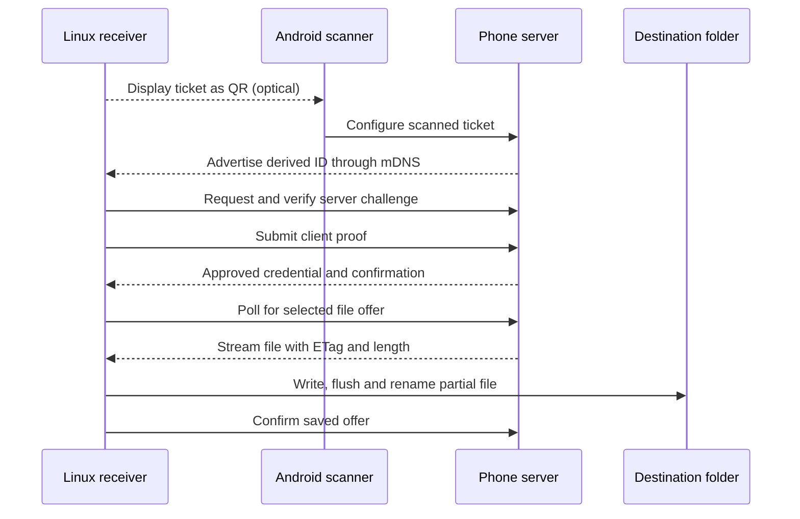

# Architecture

The Android app hosts the local HTTP server. The receiver initiates connections to the phone after discovery. Pairing therefore does not require the phone to open an inbound connection into Chromebook Linux.

## Pairing

The receiver generates a random 256-bit QR ticket. The phone decodes it locally and advertises a derived identifier using Android NSD. The raw ticket is not broadcast or submitted in the HTTP proof exchange. Both sides verify HMAC-SHA256 proofs with fresh nonces before the phone approves a remembered receiver credential. Invalid and reused tickets are rejected.

The receiver resolves matching services and probes addresses concurrently. Preflight probes only check challenges; the selected verified candidate submits the single-use pairing request. Stage events drive visible progress. Shorter attempt timeouts report a failure when discovery or connectivity is blocked.

## Files and resume

The Android Source interface opens the selected content URI and streams through bounded buffers. The receiver writes a partial file, checks available space, validates size and HTTP identity, then atomically renames the completed file. Duplicate names receive suffixes.

Pause keeps partial data. Resume uses Range and If-Range against a matching ETag; a different offer can require a fresh download. A receipt is sent only after the receiver finishes writing. The sender uses that receipt to display Saved.

## Trust boundary

QR proofs authenticate the optical ticket. HTTP file traffic and remembered bearer credentials remain visible to a network observer. This is an explicit preview limitation. The phone uses private application preferences, and Linux pairing settings are saved with owner-only file permissions. Neither is part of this repository.
